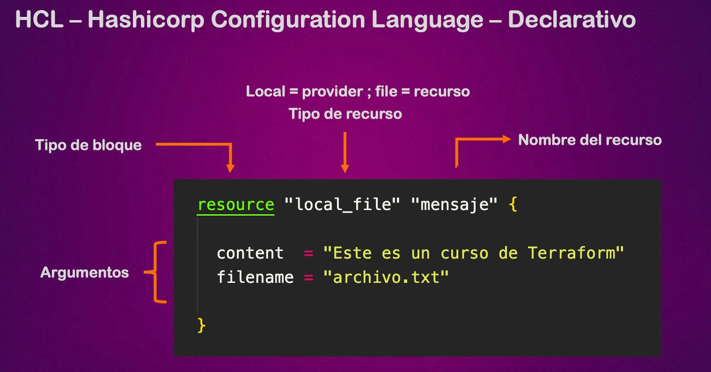

# Terraform

Este es un repositorio con fines didácticos que continen prácticas con terraform que ejemplifican su uso, propósito, la aplicación de buenas prácticas y sus bases técnicas.

Terraform es un lenguaje declarativo creado por HashiCorp para crear **Infraestructura como Código (IaC)**. Es decir, para el aprovisionamiento de infraestructura de los diferentes proveedores de nube en código en lugar de configurarla manualmente por medio de la consola. Terraform es agnóstico al proveedor, es decir, funciona sin importar si el proveedor de nube es AWS, GCP, Azure, etc.

**Características**
- Infraestructura como código declarativo
- Aprovisionar recursos INMUTABLES en nuestra infraestructura
- Toda clase de recursos como instancias, bases de datos, buckets, vpc, etc.
- Podemos deployar infraestructura en múltiples providers (AWS, GCP, etc.)
- Su lenguaje es HCL: Hashicorp Configuration Language - Declarativo

La sintáxis básica de terraform es la siguiente:

La documentación de todos los proveedores de nube de Terraform se encuentra en: https://registry.terraform.io/

---

## Explicación del repositorio

Este repositorio contiene varias carpetas de práctica de terraform (practica_1, practica_2, etc). Cada carpeta ejemplifica un uso concreto de terraform, por ejemplo, practica_1 es un "hola mundo" que crea un simple archivo _productos.txt_ en local, pero que sirve para ir viendo el uso y recomendaciones de terraform. Cada práctica va a umentando su nivel de complejidad y las carpetas sirven como notas didácticas.

### Archivos .terraform

Cada carpeta contiene su propio `.terraform`, es decir, en cada carpeta se ejecuto el comando `terraform init` por separado. Sin embargo, todos los archivos `.terraform` no aparecen debido a que estan ignorados en el `.gitignore`, a excepción de "practica_1" que si contiene su archivo `.teraform` en este repositorio dejado a propósito para mejor entendimiento de la estructura de las carpetas.

### Explicación de las prácticas

- **practica_1**: Hola mundo con terraform
- **practica_2**: Principio DRY
- **practica_3**: Ejemplo con Bucket s3 de AWS
- **practica_4**: Configuración de los providers (constraints)
- **practica_5**: Variables y tipos de variables
- **practica_6**: Práctica sobre variables - parte 1
- 

### Notas del estidio

En este repo se encuentran varias notas sobre Terraform en archivos `.md`. Todas estas notas se dividen por secciones y se encuentran en la carpeta `./notas`. A continuación se presenta el índice de las notas:

---

## Comandos útiles

Para el uso de estos comandos debes entrar en alguna de las carpetas, practica_2 por ejemplo, y ejecutar: `terraform init`

- `terraform validate`: Valida la sintaxis
- `terraform fmt`: Formatea todos los archivos de tf
- `terraform providers`: Lista los proveedores de nuestros archivos
- `terraform init`: Inicializa el motor de terraform. Se debe ejcutar cada vez que se agrega un nuevo proveedor para que el motor instale las dependencias de ese proveedor.
- `terraform plan`: Muestra un plan de los cambios que se van a ejecutar
- `terraform apply`: Aplica los cambios de la infraestructura declarada. Siempre lleva implícito un _terraform plan_ que te muestra los cambios y te pide confirmación previo a ejecutarse.
  - `terraform apply --target aws_subnet.public_subnet`: El parámetro "target" sirve para indicar el recurso específico al que queremos aplicar el cambio. Es útil cuando, por ejemplo, nos urge aplicar algún cambio solo en un recurso específico de nuestra infraestructura, pero no de toda la configuración porque posiblemente no este lista.
  - `terraform apply --auto-approve=true`: Para que no nos pregunte confirmación al aplicar la infraestructura
- `terraform destroy`: Destruye la infraestructura declarada.
- `terraform show`: Te muestra el estado actual de la infraestructura
- `terraform output`: Te muestra los outputs definidos (ver práctica 6 como ejemplo)
  - También se puede ver el output específico si conoces el nombre: `terraform output ec2_public_ip`
- `less terraform.tfstate`: Muestra información del state
- `terraform graph`: Da una lista de las dependencias en un tipo grafo
  - Para pasarlo a svg usa `terraform graph | dot -Tsvg > graph.svg`

**comandos de state**
- `terraform state list`: Muestra una lista de recursos desplegados
- `terraform state list show <recurso>.<nombre del recurso>`: El nombre del recurso lo puedes sacar del comando de arriba. Muestra un solo recurso a detalle
- `terraform state mv`: Cambia el nombre de un recurso en el state. Eso con el fin de conservar la infraestructura y solo cambiar el nombre lógico en lugar de que se destruya y re aga de nuevo.
- `terraform state rm`: Borra el seguimiento de un recurso del state. Una vez que borramos el recurso tenemos que eliminar o comentar el código del recurso