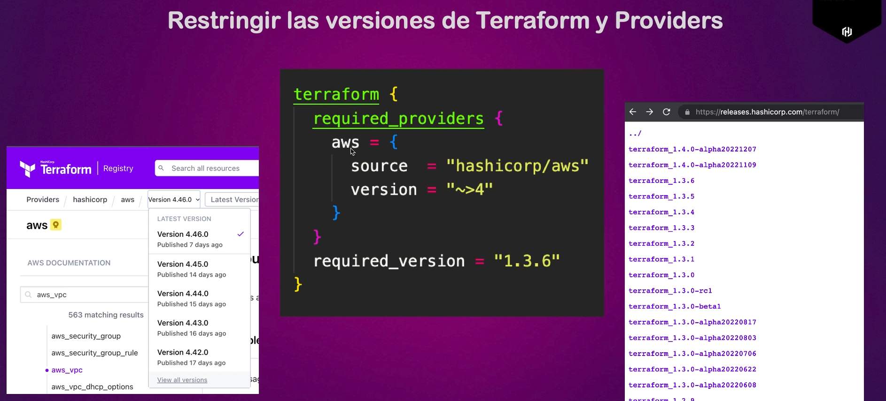
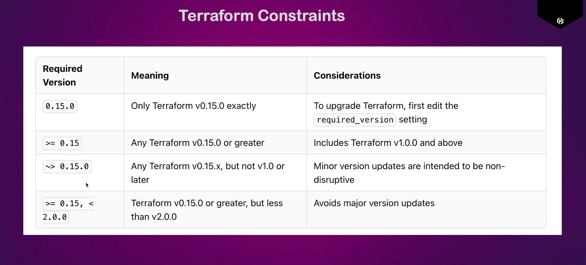

# Versiones

Terraform actualiza constantemente sus versiones para agregar, cambiar o modificar proveedores y otros componentes. Por lo tanto, es importante acordar en la organización qué versión de terraform se utilizará.

