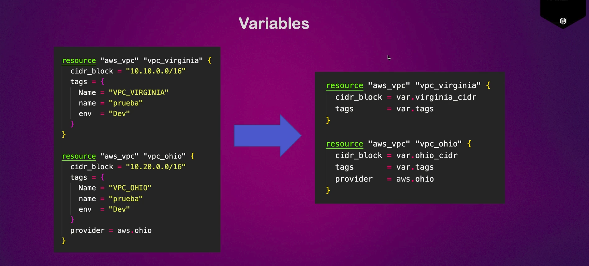
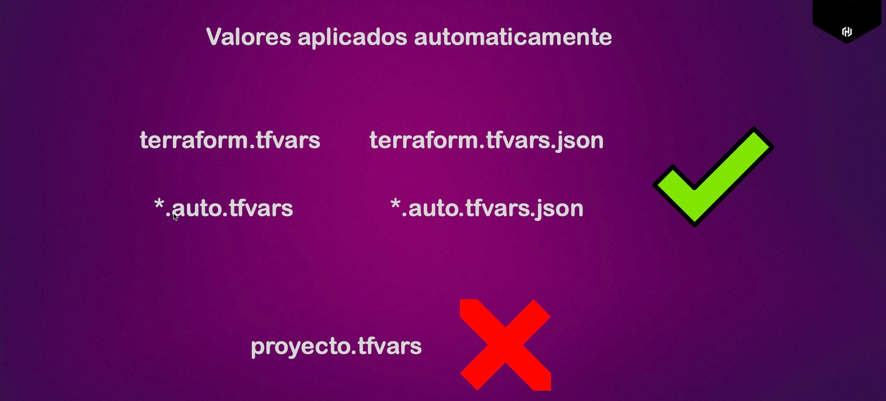
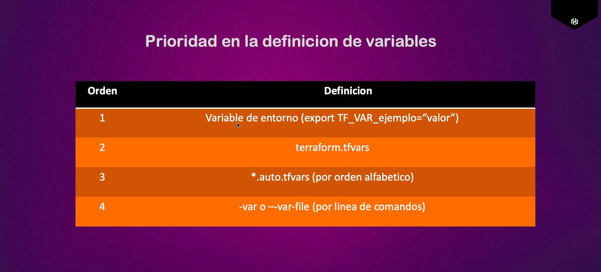

# Variables

Se abstraen los valores para abstraer más la configuración. Aquí por ejemplo, no nos importa mucho que valores tienen las VPCs pero si nos importa saber que se están configurando unas VPCs



## Variables de entorno

Otra forma es asignar variables mediante variables de entorno. Para ello hacemos lo siguiente:
1. Exportar la variable de entorno: `export TF_VAR_virgina_cidr="10.10.0.0/16"`
   1. Notese que toda variable de terraform debe empezar con "TF_VAR", seguido del nombre exacto de la variable, en este caso en el código de `practica_5` la variable se llama "virginia_cidr", pues aśi la llamamos aquí también.

Si asignas las variables de tf mediante variables de entorno necesitas dejar la variable vacía en el archivo `.tf`, por ejemplo:


En consola: `export TF_VAR_virgina_cidr="10.10.0.0/16"`

En el archivo de tf:

```tf
variable "virginia_cidr" {
}
```

## Archivo terraform.tfvars

La forma más común de asignar variables es manejarlas mediente el archivo `terraform.tfvars`. Para ello se hace lo siguiente:
1. Se crea un archivo `terraform.tfvars` en la raíz
2. Se asignan las variables de la siguiente manera:
```
virginia_cidr = "10.10.0.0/16"
ohio_cidr  = "10.20.0.0/16"
```
3. Se crea un segundo archivo llamado `variables.tf` donde únicamente se colocan las definiciones de las variables vacías, por ejemplo:
```
variable "virginia_cidr" {}
variable "ohio_cidr" {}
```
4. Las mandamos a llamar en cualquier recurso, por ejemplo:
```
resource "aws_vpc" "vpc_abdiel_virginia" {
  cidr_block = var.virginia_cidr
  tags = {
    Name  = "vpc_abdiel_virginia"
    env   = "Dev"
    owner = "Abdiel"
  }
}

resource "aws_vpc" "vpc_abdiel_ohio" {
  cidr_block = var.ohio_cidr
  tags = {
    Name  = "vpc_abdiel_ohio"
    env   = "Dev"
    owner = "Abdiel"
  }
  provider = aws.ohio
}
```

Al ejecutar `terraform plan`, por ejemplo, terraform asigna las variables si las definimos de esta forma.

Reglas para que el archivo de variables se cargue automaticamente:



Si deseas que un archivo se cargue de forma forzada sin cumplir con las reglas de arriba, puedes ejecutar: `terraform plan --var-file mi_nombre.tfvars`. Sin embargo, esta no suele ser la forma en la que se trabaja, sino con nombres siguiendo las reglas de ariba.

## Prioridades

Como vimos, hay varias formas de definir variables. Si se define la misma variable sobreescribiendose, se toman las siguientes prioridades:

