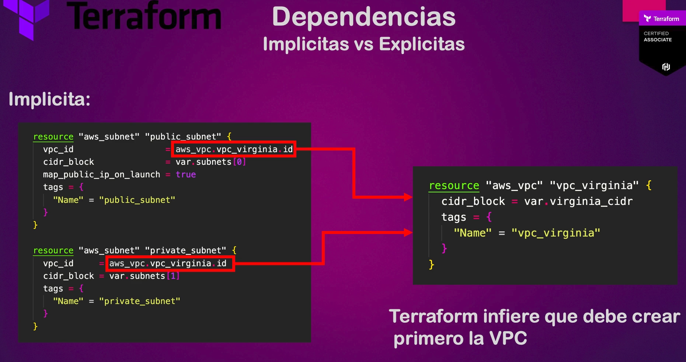
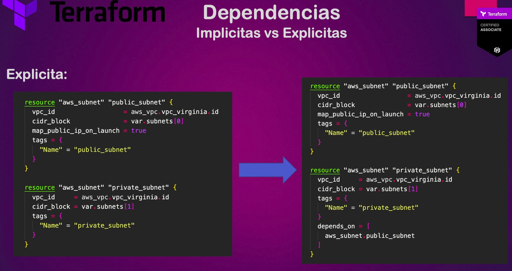

# Dependencias implícitas y explícitas

Por default, terraform es un lenguae declaravito, es decir, le decimos qué infraestructura queremos crear pero no le decimos cómo crearla, de eso ya se encarga su motor. Existe una forma implícita y otra explícita como le podemos indicar a tf el orden de los recursos que debe crear en nuestra infraestructura.

## Implícita

Esta es la forma en la que comunmente trabajamos por default. Por ejemplo, en la práctica 6 creamos una vpc y 2 subnets. Ahí tf infiere que necesita crear primero la VPC, porque no podemos tener subnets sin VPC, y posteriormente las subnets. Por lo tanto, se crea primero la VPC y después las 2 subnets se crean en paralelo. De forma implícita se le esta diciendo a tf que cree primero una cosa antes de otra.

## Explícitas

Se puede "forzar" a un orden de despliegue de nuestra infraestructura, es decir, decirle a tf de forma **explícita** el orden de cómo queremos que se creen las cosas. Para varios casos puede resultar útil. Esto se logra con la sentencia `depends on`, a continuación se muestra un ejemplo donde "forzamos" a que antes de que se cree la subnet privada, primero si o si debe crearse la subnet pública. En la vida real este caso no tiene sentido, aquí se hace solo para ejemplificar la sentencia `depends on`:

