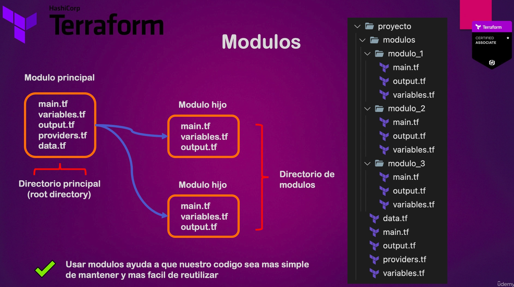

# Módulos



Los módulos sirven para agreupar configuraciones y hacer nuestro código más prolijo. Nosotros podemos crear nuestros propios módulos, si la empresa lo desea puede estandarizar el uso de módulos, podemos utilizar módulos oficiales y de terceros. En Terraform Registry hay módulos. Ejemplo: https://registry.terraform.io/browse/modules

## Estructura de un módulo
Véase la práctica 8 como referencia a los módulos. Aquí hay un módulo propio

**main.tf**

Se utiliza para declarar los componentes, por ejemplo, un bucket

**variables.tf**

Misma función para declarar variables, solo que en módulos NO utilizamos un archivo terraform.tfvars. Los valores se declaran en la raíz, en este caso se declararon en `practica_8/vpc.tf`

**output.tf**

Si quereos acceder a un valor del recurso con un output, no basta con llamarlo desde la raíz (practica_8), tenemos que establecerlo también en un archivo `output.tf` dentro del módulo

**Estructura básica de un módulo**

```hcl
module "mybucket" {
  source      = "./modulos/s3"
  bucket_name = "nombreunicopepelgrillo-1234567" # Por ahora le ponemos un nombre equis pero siempre hay que asegurarse que sea único

}
```


## Módulo para el tfstate

Como vimos anteriormente, es una mala práctica gaurdar el tfstate en el repositorio debido a que puede contener credenciales sensibles, para ello se recomiendo utilizar un bucket en la nube y que solo una persona modifique y acceda al tfstate. Existen módulos que nos simplifican el trabajo con el tfstate y son una buena opción. Por ejemplo el módulo [tfstate-backend](https://registry.terraform.io/modules/cloudposse/tfstate-backend/aws/latest), el cual utilizamos en la práctica 8 en `vpc.tf`

### MOver nuestro tfstate a la nube
Mover el tfstate a la nube en un bucket y en una DynamoDB con AWS

1. Importar [tfstate-backend](https://registry.terraform.io/modules/cloudposse/tfstate-backend/aws/latest), en este caso se importo en `practica_8/vpc.tf` como:
```hcl
module "terraform_state_backend" {
  source = "cloudposse/tfstate-backend/aws"
  # Cloud Posse recommends pinning every module to a specific version
  version    = "1.9.1"
  namespace  = "example"
  stage      = "prod"
  name       = "terraform-abdiflash-753698"
  attributes = ["state"]

  terraform_backend_config_file_path = "."
  terraform_backend_config_file_name = "backend.tf"
  force_destroy                      = false
}
```
3. Ejecutar `terraform apply --auto-approve`. Esto va a crear un bucket y DynomoDB en AWS donde guardar el tfstate. En nuestro repositorio local creará el archivo `backend.tf`. Como puedes ver dentro de `backend.tf` esta todo declarado en `terraform`, lo cual es igual como si lo pusieramos dentro del archivo `providers.tf`
2. Ejecutar `terraform init` en la raíz (practica_8/). Esto inicia el bucket y pregunta si queremos copiar el tfstate local al bucket, le decimos que si y ha quedado migrado. A partir de ahora TF va a utilizar el tfstate del bucket
3. Borrar el tfstate local con `rm -rf terraform.tfstate*`
4. Comprueba todo con `terraform plan` para ver que todo sigue en orden

### Recuperar el tfstate de la nube al local

Para recuperarlo tendríamos que descargarlo del bucket y colocarlo en nuestra máquina local. Pero TF nos provee una forma simplificada;

1. Ejecutar `terraform state pull > terraform.tfstate`
2. Ejecutar `terraform init` para migrar el uso del tfstate local
3. Ejecutar `terraform init -migrate-state`. A partir de ahora ya estaremos trabajando en el local. Se puede borrar el de la nube y el posible versionamiento de tfstate que hayan quedado