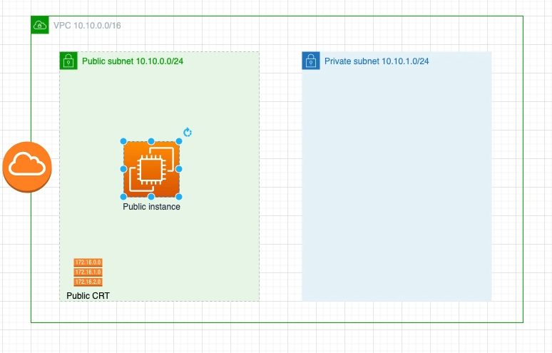

# Infraestructura de la práctica 6

En esta sección se crea la siguiente IaC con TF

## Conectarse a la EC2

Necesitamos el archivo myken.pem para conectarse, si lo perdiste o no lo tienes tienes que generar uno nuevo y asignarlo en data.tf

Para conectarse por ssh:
1. `chmod 400 mykeyabdiel.pem`
2. `ssh -i mykeyabdiel.pem ec2-user@54.146.182.221` 

ec2-user es el user por dafault